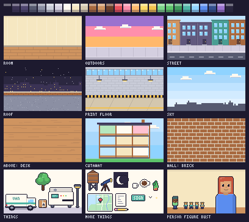

# Newsletter covers

Every newsletter post has a cover: small pixel art that looks like it was drawn inside HQ. The house style is in the
size, the palette and the drawing, never in one composition. The feed is a wall of these covers, and a wall of the same
shot gets dull fast, so each cover picks its own place, shot and scale for its story.

The kit helps, it never limits. Its places, things and people are shortcuts for
what covers drew before, so a cover built only from them looks like the covers before it. Start from the story's own
picture and draw what it needs.

## The format

- **128 × 72 pixels, PNG, still.** One art pixel is one image pixel; HQ scales it up crisply. No
  animation, no video, no photos or screenshots, no anti-aliasing, no gradients (stepped bands only).
- **Drawn in code**: a `cover.js` next to the post's `index.md`, rendered to `cover.png` beside it. Keep both in the
  repo, so a cover can be fixed later. The paint helpers (`R`, `P`, `box`, `disc`, `line`, `sprite`) draw anything
  pixel by pixel.
- A post that is about a sound carries it as `sound:` (an .m4a next to the post). It plays only when
  tapped. Product footage belongs in the product's deck, not the newsletter (one exception: a film made for
  the board, embedded in the post's text; see the knowledge playbook's rules). The cover stays a still.

## The look (the same on every cover)

- **The palette is HQ's** (`C`), with one highlight (`lite`) and one shade (`dark`) per colour. Nothing outside it.
- **Light from the top left.** Blocks get a highlight on the top and left edges and a shade on the bottom and right
  (`box`).
- **Two layers.** The place behind has no outlines. Everything in front goes through `fg`, which gives its silhouette
  one ink outline (people outline themselves). Standing things cast a soft `shadow`.
- **One pixel size.** Draw a close-up bigger, never scaled up: a 2x sprite next to 1x pixels looks smudged.
- **Words only in the world**: a sign, a label, a screen, in HQ's 3 × 5 font (`text`), and short.
  The title lives next to the cover, not on it.
- **Readable at card size:** one idea, big shapes, few colours per object, the subject readable in a glance.

## Find the picture (different every time)

Read the story and ask what one picture would tell it at a glance, before you look at what the kit has. Then look at
the last few covers in the feed (`node shared/covers/render.mjs --recent`) so the new one doesn't repeat their set-up:

- **The place.** Where would this story happen? Often somewhere no cover has been yet: a beach, a market, inside the
  printer, a parcel's view of the sorting belt, a customer's kitchen (invented), the moon. Draw it. A room only when
  the story really is about a room.
- **The scale.** One stamp's face filling the frame, a single key, tiny figures in a huge place, the whole town from
  far off, something giant next to someone small.
- **The shot.** A close-up, a portrait, a medium shot of people doing something, a wide view, from above, from below.
- **Who's in it.** The author, the people the story is about, invented customers or a crowd, or nobody: a cover
  without people is fine when the thing tells the story.

Two covers in a row in the same place, at the same scale, or with the same "thing in the middle, author beside it"
shot, is one too many. Don't reach for a red cross either: show what's new, not what's gone.

## The kit



`kit.js` gives a cover everything below (`draw(g, kit)`). Places fill the frame and draw no outlines; things draw
no outline either, so draw them inside `fg`; people outline themselves.

| | What | Where feet go |
|---|---|---|
| **Places** (`places.js`) | `room` (wall and floor), `outdoors` (sky and pavement) | y 62 |
| | `street`: house fronts, pavement, road, by day, dusk or night (lit windows) | pavement y 57, wheels y 69 |
| | `roof`: the skyline over the parapet, a gravel deck | y 63 |
| | `printFloor`: block walls, high windows, lamps, a walkway | y 63 |
| | `sky`: the sky alone, a line of roofs at the bottom (`roofs: false` for none) | nowhere: things fly |
| | `above`: a surface seen from above (`desk`, `mat`, `grass`, `floor`) | nowhere: things lie on it |
| | `cutaway`: the building cut open; returns its rooms (`{ x, y, w, h, floor, room, foot }`) | each room's `foot` |
| | `wall`: one wall filling the frame for a close-up (`plain`, `brick`, `cork`, `tiles`) | the frame's foot |
| | details: `windowPane`, `cloud` | |
| **Things** (`things.js`) | `van`, `parcel` (`top` from above), `printer` (returns its paper slot), `streetLamp`, `tree`, `waterTower`, `telescope`, `moon`, `star`, `bird`, `sign`, `mug` (`above`), `sheet`, `pencil`, `map`, `pin`, `plant` (its pot's colour `POT`) | |
| **People** (`people.js`) | `person`: a team member as HQ draws them (frames: stand, walk1, walk2, sit, type1, water; items: box, paper, cup, umbrella) | `foot` |
| | `figure`: small, 5 × 10, for wide shots and cutaways (stand, walk, wave, carry) | `foot` |
| | `bust`: head and shoulders, 32 wide, for a portrait (`mouth`: smile, open, flat) | off the frame's foot |
| | `cat`, `prop` (HQ's desk things), `agent` (a sprite without outline) | |
| **Paint** (`paint.js`) | `W`, `H`, `FLOOR`, `C`, `lite`, `dark`, `mix` (a step from one colour to another), `R`, `P`, `box`, `disc`, `line`, `shadow`, `text`, `textWidth`, `fg`, `sprite` (rows of characters, one per pixel) | |
| **Logo** (`logo.js`) | `wordmark`: the company's logo from `company/brand.yaml` (its pixels, the accent mark and its seam), in its colours or those given; `logo()`: its pixels and colours | |

Every person, figure and bust is the team member's own look from `company/org.yaml`. Any other id draws an invented
person, the same look for the same id (`figure(g, 'guest-ines', …)`): customers, passers-by, a crowd. Something the kit can't draw
yet: draw it in the cover with `R`, `box` and `sprite`, and if more covers will want it, add it to `things.js`.

## Worked examples

The `cover.js` files in `examples/` show how to draw things: `street-delivery.js` (a van in a street),
`roof-at-dusk.js` (a stepped dusk sky), `print-floor.js` (a long sheet out of the printer), `desk-from-above.js` (a
surface from above), `cutaway-at-night.js` (small figures in a cut-open building), `portrait.js` (a bust),
`close-up-label.js` (one object filling the frame) and `night-sky.js` (an idea drawn in stars). Read one for its
technique, not its set-up: the feed has used each of them already, so a copy repeats the feed.

## Make one

```js
// knowledge/posts/<date>-<slug>/cover.js: the parts of a cover, not a set-up to copy
export default (g, { W, C, R, lite, fg, outdoors, parcel, figure }) => {
  outdoors(g, { time: 'dusk' });                                       // the place: the kit's, or drawn with R and sprite
  R(g, 0, 60, W, 2, lite(C.pave, 0.3));                                // anything the kit doesn't have, pixel by pixel
  fg(g, g => parcel(g, 30, 8, 64, 54, { label: 'ONE' }));             // the subject, at the scale the story needs
  figure(g, 'ada', 104, 62, { frame: 'wave' });                        // the people: tiny here
};
```

```sh
node shared/covers/render.mjs knowledge/posts/<date>-<slug>/cover.js --recent   # writes cover.png, and a sheet of it
                                                                                # next to the feed's last six
node shared/covers/render.mjs --all                                             # every post's cover
```

Then look at the sheet before you publish: is the new cover readable at card size, and does it look unlike the
covers before it and the worked examples? `reference.js` renders the sheet above.
